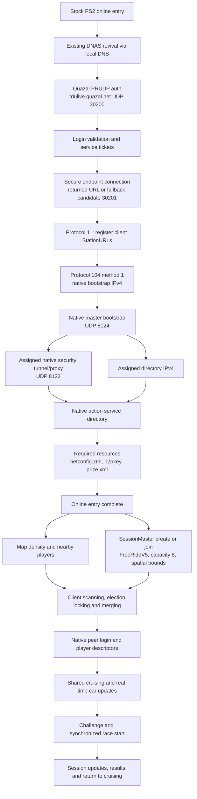

# How TDU PS2 goes online

Research provenance: these findings were produced in the sibling `tdu-server`
workspace. Runtime package paths below refer to Quetzal; `tools/`, private
`work/` evidence and Ghidra projects refer to that original research workspace.
Keep those private files there; Quetzal has no runtime dependency on them.
See [running.md](running.md) for current Quetzal operation.

This is the entry point for the US `SLUS-214.90` protocol investigation.
The map is based on executable/overlay analysis and offline checks, not a
successful retail session against a replacement server. A runnable backend now
passes synthetic-client UDP integration tests; see [running.md](running.md). The recovered crypto has
[usable Go codecs and native checks](crypto-implementation.md). The exact build and address
mapping are in [analysis.md](analysis.md).

**The game combines backend-assisted discovery with small peer groups.**
The backend authenticates accounts, introduces the native network services,
supplies configuration and coordinates moving FreeRide sessions. Native
client code handles the participating drivers and the real-time actions.
This is substantially more than a race-room list, but the recovered code does
not support treating the backend as one giant authoritative car simulation.

## Connection and gameplay map

The arrows summarize dependencies and recovered client paths, not every
individual packet or optional branch. The full native envelope, directory,
configuration, peer and race return paths still need stock-client capture
validation. A returned/configured service address can differ from the initial
hostname's address.

## Separate protocols and responsibilities

| Layer | What it does | Format / evidence | Detailed map |
| --- | --- | --- | --- |
| DNAS | Existing revival server reached through local DNS; user-confirmed setup | Client gate at `0x3789c0`; outside remaining revival scope | Boot notes below |
| Quazal PRUDP | UDP connections, reliability, framing and stream payload handling | Packed 10-byte prefix, LE fields, optional extensions, checksum | [transport.md](transport.md) |
| Quazal RPC | Accounts, tickets, secure address registration, social and custom services | Protocol byte + call/method IDs, LE fields, SDK Strings/Buffers | [authentication.md](authentication.md) |
| Native master/tunnel | Bootstraps and secures the edNet connection | Master exchange and separate native encrypted tunnel | [gameplay.md](gameplay.md) |
| edNet directory/resources | Routes action IDs to services and fetches required files | Native action/reference encodings; request-handler and ORB resource services | [world-and-sessions.md](world-and-sessions.md) |
| SessionMaster / DensityMap | Finds nearby drivers and maintains bounded FreeRide session records | Native request IDs and title-specific descriptors | [world-and-sessions.md](world-and-sessions.md) |
| CP2P gameplay | Admits peers and exchanges player, car and race state | BE action IDs/scalars, CRC-derived identifiers, peer descriptors | [gameplay.md](gameplay.md) |

Quazal's generic NAT-traversal code, the native tunnel and the actual peer-game
messages are related components, not interchangeable packet formats. There is
no basis for applying AngelWare's DemonWare frames or STUN messages to them.

## Endpoint inventory

| Endpoint / number | Established meaning | Limit |
| --- | --- | --- |
| `tdulive.quazal.net:30200` | Initial Quazal account/auth setup | Static config; no live exchange captured |
| Port `30201`, `PID=2` | Initial secure URL fallback selected by default SDK state | Returned connection data/runtime state can override it |
| Protocol 104 / method 1 result | Four-byte native bootstrap IPv4, no arguments in request | Not a complete endpoint record; not necessarily the final proxy address |
| UDP `8124` | Native master bootstrap destination | Reply supplies proxy IPv4 and directory IPv4; see [startup-handoff.md](startup-handoff.md) |
| UDP `8122` | Native proxy/tunnel destination; also appears in native client descriptors | Different role from Quazal auth and direct peer socket fields |
| Port `8889` | Advertised native peer/client endpoint | Inspect NAT adapter/capture before assuming every peer uses that literal port |
| Directory-returned IPv4/port pairs | Native action-service routing | Logical ports select installed local handlers through the proxy; they are not separate UDP listeners |

## Account and ticket services

The recovered Quazal IDs are concrete client registrations:

| Protocol | Recovered purpose |
| --- | --- |
| 10 | Ticket-granting/login and service-ticket acquisition |
| 11 | Secure connection registration and StationURL exchange |
| 25 | Account management; signup temporarily logs in as guest |
| 102 | Challenge store |
| 103 | Event statistics |
| 104 | AMH Lair/native bootstrap lookup |

Login password derivation uses repeated MD5 with `65000 + PID % 1024` rounds.
Signup sends a hexadecimal initial digest after 65000 rounds. Ticket containers
use RC4 and HMAC-MD5, with account-derived/session keys; the generic transport
key and checksum seed have different roles. The login validation buffer,
service-ticket envelope and destination's opaque ticket are distinct records.
The complete field orders and implemented challenge/reply codecs are in the auth map.
The native tunnel has its own overlay cipher/authentication, and the downloaded
16-byte `p2pkey` protects a separate peer wrapper. Reusing one key or decoder
across these contexts would lose the distinctions present in the client.

## What makes shared cruising work

The FreeRide builder names sessions `FreeRideV5`, sets capacity to eight and
computes a bounding rectangle around the driver's position. SessionMaster
create-or-join results distinguish creating a group from joining one. A separate
client manager scans peers, elects a group master, handles lock/isolation and
slot reservation, and merges groups. Density queries also incorporate online
friends; seeing dots on the map is separate from sharing a synchronized group.

After discovery, native peer login exchanges a session/game identity and a
player descriptor. The action family includes car physics, position, player
state, weather, horn/windows, keepalive and race-start synchronization.
These are real-time participants in the driving world. The server must keep
identities, advertised addresses, session ownership and routing consistent for
the client-side group logic to work. Native action IDs are only 16 bits: the
directory reply and a peer physics action both hash to `0xee87`. Route them
using the service/object/request context; a single global unique-ID switch
would misclassify valid messages.

## Boot and configuration gates

The DNAS UI path `0x3789c0` displays the authentication stage, starts the check
through the DNAS wrapper and imposes a 60-second deadline. Its success branch
advances the online-entry state to 3; its failure/timeout branch reports a
separate DNAS error. The disc includes `DNAS300.IMG` and an overlapping
`DNASSCEE` overlay. The user confirms DNAS is already handled by an existing
revival server reached through local DNS. Keep using that setup. This client
gate is retained in the architecture map for sequence accuracy; DNAS revival
and certificate/trust research are not outstanding work for this project.

After Quazal/native connection, UI state 6 requires server configuration and
state 7 waits for three client resource callbacks: `netconfig.xml`, `p2pkey`
and `prize.xml`. The mapped fetch bounds are 4096, 16 and 4096 bytes respectively.
Bounds are client allocations, not a statement that every file must have that
exact size. Resource contents, identifiers and error behavior must satisfy the
actual readers; simply replying 'success' is insufficient.

## What is verified and what is next

| Area | Current evidence | Required next validation |
| --- | --- | --- |
| Build and main/overlay locations | Disc inventory, hashes and loader evidence | Confirm only when adding another build |
| PRUDP frame/checksum | Matching reader/writer and 344 retail checksum executions; offline malformed-frame tests | Fresh retail SYN/CONNECT/DATA capture |
| RPC/auth/tickets | Persistent signup/accounts, tickets and secure registration tested over UDP | Fresh retail login and correct/incorrect-password traces |
| Native bootstrap/tunnel | Real UDP master, signed DH, encrypted activation and replay/retry tests | Fresh retail security exchange |
| Required resources/directory | Native-executed initial handoff and Open/Get request/reply checks; configured local routing | Retail acceptance of generated configuration and completed startup |
| FreeRide and discovery | Implemented transport-owned SessionMaster, presence/density and bounded Quazal introductions; native serializer fixtures | Two clients finding/joining the same moving group |
| Challenge/statistics services | Authenticated protocols 102/103 storage and queries, native record fixtures | Retail browser/report behavior and replacement ranking policies |
| Actual cruising/races | Native action inventory and login/start handlers | Bidirectional car state, race start/completion and clean return |

The next validation milestone is **one stock client reaching completed
online startup**, including both Quazal and native backend stages. The next
multiplayer milestone is **two clients cruising together**. A completed race,
group merging, strict-NAT behavior and physical hardware are separate checks.
See [roadmap.md](roadmap.md) for the ordered work and acceptance criteria.

Current service maps: [directory/resources](native-services.md),
[directory handoff](startup-handoff.md), [SessionMaster](sessionmaster.md),
[presence/density](presence.md), [peer introductions](peer-connectivity.md),
and [challenge/statistics](title-services.md). Native transport connection IDs
and Quazal account PIDs are separate namespaces; a self-reported native ID is
not account proof. Implemented discovery does not establish completed cruising.

## Evidence sources

The main evidence is the user-supplied executable and overlays; decompilation
and binary-derived research stay in ignored `work/`. Each detailed map lists
virtual addresses and retained query logs. No game binaries or decompiled source
are included in the project documentation.

A pinned public reference provides useful cross-checks for the broad edNet
service split and the four-byte Lair result. Its native handler lists other
client versions, so it is not proof of stock PS2 compatibility. See
[external-references.md](external-references.md).
