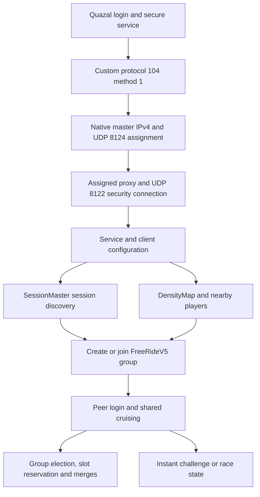

# Shared world, service discovery and sessions

Research provenance: these findings were produced in the sibling `tdu-server`
workspace. Runtime package paths below refer to Quetzal; `tools/`, private
`work/` evidence and Ghidra projects refer to that original research workspace.
Keep those private files there; Quetzal has no runtime dependency on them.
See [running.md](running.md) for current Quetzal operation.

Investigation of the US PS2 `SLUS-214.90` executable, begun 2026-11-15,
with subsequent native-routine fixtures and runtime implementation.
Addresses below are virtual addresses in the main ELF identified in
[analysis.md](analysis.md). No successful retail online session has been captured
for this project. The code proves the client paths below; server-side policies,
map contents and timing under real load remain unverified.

## The architecture visible in the client

The PS2 executable contains three distinct layers:

1. Quazal Rendez-Vous authenticates the player and supplies a native backend bootstrap address.
2. An edNet master assigns a security proxy; a separate security connection,
   service directory and configuration flow brings up the game backend.
3. SessionMaster and DensityMap services coordinate world presence and sessions;
   native CP2P code builds the small group of drivers who actually exchange game
   traffic.

This is a useful implementation boundary: restoring Quazal login alone cannot
complete the online-entry sequence. The game explicitly waits for proxy
information, security connection success, server configuration and client
configuration before reporting that login is complete.

## Quazal's custom service registrations

`0x1e2c30` constructs and registers these client objects after login:

| Protocol | Client class | Local role established so far |
| --- | --- | --- |
| 102 / `0x66` | `ChallengeStoreProtocolClient` | Implemented authenticated challenge upload/download/list; see [title-services.md](title-services.md) |
| 103 / `0x67` | `EventStatsProtocolClient` | Implemented linked report/query operations; response dispatcher at `0x2417d0` handles methods 1–11 |
| 104 / `0x68` | `LairAccountManagementProtocolClient` | Mandatory native backend bootstrap-address query |

The class identities are tied to RTTI and vtables, not just nearby strings:
`0x562770` → ChallengeStore, `0x562840` → EventStats and `0x562ba0` →
LairAccountManagement. Their registration calls pass the protocol numbers above.
These services are separate from the native SessionMaster request identifiers.

### Protocol 104, method 1

The request builder `0x247bc0` writes method selector 1 and **no method arguments**.
It registers one output slot. Response dispatcher `0x247b10` accepts response
selector `0x8001` and extracts **exactly four bytes** into output slot zero.

`0x1e2360` submits this request into state offset `+0x28`; getter `0x1e2c20`
returns that value. The online-entry state machine waits until it is nonzero,
then `0x377b80` passes it through the 32-bit endian-conversion routine `0x13aca0`
into the edNet security connection's remote-address argument. Together these
call sites identify the result as a **native backend/bootstrap IPv4 address**.
Following the native constructor at `0x1553b0` establishes the next step: an
eight-byte master request goes to that address on UDP **8124**; the reply assigns
a proxy address used on UDP **8122** and a separate directory IPv4. The latter
is copied into the manager descriptor by `0x377b80`; see
[startup-handoff.md](startup-handoff.md). Thus the four-byte Quazal result is not
necessarily the final tunnel proxy. It contains no port, host string, session
key or full connection record.

A nearby scalar in the connection call is assembled from bytes `0x5ea9de` and
`0x5ea9df`. Those same bytes are compared against `it`, `fr`, `sp`, `ge`, `us`,
`ja` and `gb` by formatting code at `0x374b60`. It is a language/region tag;
interpreting it as a network port would be an analysis error.

A public implementation independently gives this method the same four-byte
native-backend address role. It is corroboration, not retail compatibility evidence:
[PSHome-MultiServer, pinned Lair account service](https://github.com/GitHubProUser67/PSHome-MultiServer/blob/8778e985e4fbbec9ee8f29d007d256dd1df5814f/Servers/QuazalServer/RDVServices/GameServices/v2Services/LairAccountManagementProtocolService.cs).

## The online-entry state machine

`0x378380` dispatches the online login workflow. These are observed phases of
that particular UI/state object, not Quazal protocol method numbers:

| UI state | Code path | Gate before moving onward |
| --- | --- | --- |
| 3 | `0x377f90` | AMH Lair login completes, then starts the custom backend-address query |
| 4 | `0x1e2c20` | Four-byte bootstrap address becomes nonzero |
| 5 | `0x377b80` | Native security connection reaches its internal state 6 |
| 6 | `0x377a00` | Native directory batch succeeds; retries failed queries up to ten times |
| 7 | `0x377880` | Required client configuration callbacks complete |
| 8 | `0x378380` | Outstanding connection setup drains; displays successful login |

The error branches distinguish failure to retrieve proxy information, security
proxy errors, failure to contact the login game server and timeouts waiting for
that server. They are not one interchangeable login failure.

Native security connection state 6 is a different state variable from UI state 6.
`0x377b80` installs connection callbacks at `0x3a12f0`, `0x3a14b0`,
`0x3a1520`, `0x3a1350` and `0x3a12d0`. The native transport/crypto investigation
must implement the contract these callbacks expect, rather than simply forcing
the UI state to advance.

The client configuration phase requests three resources and waits on three
completion flags:

| Resource | Request function | Client buffer limit | Completion flag |
| --- | --- | --- | --- |
| `netconfig.xml` | `0x461ed0` | 4096 bytes | `0xa9bf60` |
| `p2pkey` | `0x4614b0` | 16 bytes | `0xa9bf68` |
| `prize.xml` | `0x461c80` | 4096 bytes | `0xa9bf70` |

The resource names are confirmed by the actual request arguments, including
`p2pkey` at `0x539f9b` and `prize.xml` at `0x539fc7`. The P2P key completion
callback `0x4613c0` requires success and nonempty data, clears 16 bytes at
`0x4e6e30`, copies up to 16 downloaded bytes there, and sets `0xa9bf68`.
This downloaded peer-key material is separate from Quazal login/session keys.
The read-only open/get wire format is now recovered and implemented in
`internal/games/tdu/ednet`; see [native-services.md](native-services.md). The numeric network-setting schema/defaults and no-pending-prize schema are
now recovered, with server-owned generators in `internal/games/tdu/ednet`. Their retail
acceptance and populated prize-grant behavior still need validation. `p2pkey` is a persistent sixteen-byte server-selected peer
obfuscation key; see [peer-security.md](peer-security.md).

## Native service directory and endpoint separation

The executable contains these explicit service-directory schemas:

- `coreresquests::r_get_request_handlers(ushort request_crc_in[COREREQUESTS_MAX_GETRPC_HANDLERS])`
- `coreresquests::a_get_request_handlers((ushort request_crc_in,uint ip_address,ushort port)[COREREQUESTS_MAX_GETRPC_HANDLERS])`
- `coreresquests::r_get_request_handler(ushort request_crc_in)`
- `coreresquests::a_get_request_handler({uint ip_address,ushort port}=NULL)`

The strings reside at `0x539d27`, `0x539ca2`, `0x539dcf` and `0x539d86`.
They establish a native directory keyed by request identifier, returning IPv4/port
pairs. Builder `0x460b90` starts a request with signature hash **`0xc7bc`**,
then writes **exactly five u16 requested action IDs**, with no count field in
that method body. The reply signature is **`0xee87`**. Recomputing it from
the raw NUL-terminated bytes at `0x539ca2` gives CRC-32 `0xf2c41c43` and
XOR-fold `0xee87`, matching the string checked by `0x460960`.

The native physics investigation independently found `0xee87` for a different
peer action. These 16-bit hashes can collide: dispatch requires the service,
pending request or peer-channel context. A single global enum assuming one
unique meaning per value would misdecode these two messages. Reply handler `0x460960` verifies the batch-reply signature, then loops
over **16 endpoint slots**. While data remain it consumes a u16 request ID,
u32 IPv4 and u16 port; otherwise it clears the remaining slots. It stores
endpoint objects with stride `0x6c`. It discards each returned request ID when
storing the endpoint: **reply order must match request order**. Sixteen is
client capacity; the observed builder requests five entries. There is no count
read in this reply handler.

Restoring a single hostname is insufficient: service endpoints must agree with
the configured proxy’s local logical routing. These codecs, framing and error
paths are now implemented and tested; the
reliable `0x509a` / reply `0x984e` transaction wrapper and read-only resource
framing are now established in [native-services.md](native-services.md).

Callback `0x460d60` installs the first five returned endpoints as follows.
The four named service roles are also supported by availability diagnostics:

| Returned slot | Destination object | Role / concrete use |
| --- | --- | --- |
| 0 | `0x5eb5d0` | Core/log RPC handler |
| 1 | `0x5eb63c` | `GAMEMASTER`: SessionMaster create-or-join and session density |
| 2 | `0x5eb714` | `GPSTRACKER`: nearby-player and map-density requests |
| 3 | `0x5eb6a8` | `USERMAP`: global user presence updates |
| 4 | `0x5eb780` | `PTS_STORAGE`: resource/configuration endpoint |

Refresh builder `0x4610e0` fills the five requested action IDs using the log
request, time request, map-density request, user-update event and a storage
action constant. This is service discovery by supported action, rather than
DNS names for five fixed services.

These are local endpoint objects, not five fixed network addresses. The
directory batch result at `0x5f092c` is exactly manager `0x5eaebc + 0x5a70`: the
UI’s “Checking server configuration” gate is this lookup, not another XML RPC.
Manager constructor `0x462b80` initially sets directory IPv4 `0.0.0.0` and logical
port 9000. Getter `0x3a0c90` can override this from GServiceOnline; its constructor
`0x3a4e90` clears the override by default. The manager’s `+0x710` field is the
IPv4 inside this descriptor, not an independent service-enabled Boolean.
Periodic refresh `0x4610e0` requires a nonzero directory IPv4. This field is
populated by the online-entry routine `0x377b80` from native connection `+0x20`,
the master reply’s second IPv4. Native-executed parser and handoff checks prove
this chain; see [startup-handoff.md](startup-handoff.md). The earlier negative
ORB/script scans missed that writer and no longer describe a startup blocker.
Port 9000 is the stock logical destination, routed through the proxy, without
any zero-address alias.

`0x410930` separately constructs an advertised client descriptor using port
`0x1fba` (8122), local network data and getter `0x1e23d0`, which returns the
registered Quazal **connection ID**. Getter `0x1e23a0` returns the distinct
account PID. Native CID claims do not prove account ownership. This descriptor
is distinct from the remote directory and the published peer-game endpoint.

## SessionMaster and request identities

The native session layer uses 16-bit action identifiers. `0x13ab70` computes
CRC-32 with the reflected `0xedb88320` table, then XOR-folds the upper/lower
16-bit halves. `0x13a530` starts a stream with a big-endian 16-bit identifier.
Constructor `0x130890` hashes the session signature strings into the same
globals that outgoing methods use. This establishes these SessionMaster IDs:

| Action | ID | Signature VA / stored global |
| --- | --- | --- |
| Create or join FreeRide | `0xe2dd` | `0x50f81f` / `0x576730` |
| Create or join reply | `0x5ce5` | `0x50f8ce` / `0x576738` |
| Update FreeRide session | `0xa518` | `0x50f7b9` / `0x576728` |
| Get session information | `0x6427` | `0x50f66d` / `0x5767a0` |
| Get session information reply | `0x7848` | `0x50f6aa` / `0x5767a8` |

The current service implements transport-owned create/update/delete, lookup,
plain and restricted browser search, lifecycle notifications and session density.
Generic base SessionV3 records and FreeRide records have distinct codecs. See
[sessionmaster.md](sessionmaster.md) for exact actions, asynchronous business
replies, ownership, expiry and replacement selection policies. Unsupported
operations return explicit errors.

`0x12f820` builds the create-or-join request. It serializes a client descriptor,
a blacklist object, a FreeRide session descriptor and a trailing u32, then sends the action to
the SessionMaster endpoint. Callback `0x4138e0` interprets result **1 as create**
and **2 as join**. It records returned session/connection information and takes
different following branches. Result 0 resets the scan with a retry delay.

## FreeRide session descriptor

The FreeRide-specific descriptor is constructed by `0x137620`, serialized by
`0x137420` and decoded by `0x137220`. Its type/version marker is the hash of
`edNetSessionFreeRide::edNetSessionFreeRideV3()` at `0x50fac0`.

The following is a field-order map from matching writer/reader calls. Memory
offsets are offsets in the client object, not offsets in a raw UDP packet.
The matching codecs and native-executed fixtures are maintained in
[sessionmaster.md](sessionmaster.md); unknown policy fields remain unnamed:

| Order | Primitive / object offset | Established interpretation |
| --- | --- | --- |
| 1 | u64 at `+0x08` | Self-reported profile identity/value; distinct from connection CID |
| 2 | u32 at `+0x80` | Session ID used by create/join callback |
| 3 | u32 from nested reference `+0x268` (resolved address at `+0x274`) | Host reference IPv4; owner update uses observed native source |
| 4 | Four u32 values at `+0x10..+0x1c` | Advertised peer port, LAN IPv4, LAN port, Quazal CID; ports use low 16 bits |
| 5 | Byte at `+0x264` | Connection/NAT-related field; exact enumeration unresolved |
| 6 | Two strings, storage `+0x28`, `+0x48` | Each has 32 bytes of client storage |
| 7 | Byte from `+0x68` | Group occupancy field |
| 8 | Byte from `+0x278` | Maximum group size; initialized to 8 by the FreeRide builder |
| 9 | Byte at `+0x280` | Opaque flag |
| 10 | Four floats at `+0x284..+0x290` | X/Z minimum and maximum bounds in FreeRide construction |
| 11 | 128-byte data area at `+0x294` | Opaque additional session data |

Strings and buffers are counted with BE u16 byte lengths; their actual
serializers and the outer action wrapper now have native-executed fixtures.
See [sessionmaster.md](sessionmaster.md) for the exact codec. The native
connection ID is still an unverified claim at this service boundary.
The base `edNetSessionV3()` codec at `0x137950` / `0x137740` has a different
sequence including additional fields; it is not interchangeable with FreeRideV3.

`0x414b20` prepares the initial FreeRide descriptor. It writes the group name
using **`FreeRideV5`**, sets maximum capacity to **8**, and constructs bounds
from the player's X/Z position minus/plus a configurable strength radius.
The default strength-radius configuration is 1500, verified in configuration
constructor `0x4095c0` from the key `P2PFR_STRENGTH_RADIUS`. Units have not been
independently established here.

## Scanning, groups, election and merging

`CP2PFreeRideMgr` is represented by the diagnostic string at `0x535e50`.
Its code has named phases for scanning, time counting, election, group-master
query/create, slot reservation, waiting for a group master, initial create/join,
session-info lookup and merge-in-progress. The presence of these strings is
supported by matching stateful code, rather than being used alone to infer a
working service.

- `0x416a00` scans up to eight local peers and builds spatial groups using
  current positions and the strength radius. It manages query timeouts and
  transitions among initial query, create, join and merge stages.
- `0x415df0` runs the group-master election. It collects confirmations,
  periodically transmits an election message, compares participant integers to
  select the elected participant, and asks SessionMaster to create or join the
  resulting bounded session. The precise semantic identity used in the
  comparison still needs tracing; do not substitute a server-generated random
  leader without checking it.
- `0x410930` submits a SessionMaster request for a merge/create-or-join operation.
- `0x4138e0` handles the asynchronous create-or-join result and retains the
  returned session/connection information for the next peer/Lair stage.
- `0x414940` starts the initial create-or-join operation with a deadline; failure
  resets to scanning with a randomized 3–8 second component plus configured delay.

Native action signatures also describe reserving slots, asking/setting lock
state with another driver, asking for isolation, issuing an isolation order,
confirming elections, creating a new group from an existing session and merging
with another session. Their presence and the matching state-machine branches
explain why holding a group together is more involved than an eight-entry race
room list.

These paths support an implementation model of small, moving groups with
backend-assisted discovery. They do not establish a single authoritative server
simulating every car across Oahu.

## Map density, nearby players and friends

The class `edNetServiceHandlerDensityMap` is constructed by `0x3bdad0`.
It computes/records signatures for map density and nearby-player operations:

| Signature | Derived 16-bit signature hash |
| --- | --- |
| `DensityMap::DensityMapGet` | `0x3c39` |
| `DensityMap::DensityMap(buffer)` | `0x3b28` |
| `DensityMap::nearPlayers(float,float,float)` | `0x047c` |
| `DensityMap::nearPlayers(byte,buffer)` | `0x7531` |

Those older DensityMap hashes are not the active stock wire IDs. The later
initializer `0x55df80` sets the real nearby/map signatures in `0xaa61xx`:
nearby request/reply **`0x42bb` / `0xc4d5`**, map request/reply
**`0x55ae` / `0xd768`**, and USERMAP update **`0x89ee`**. See
[presence.md](presence.md) for exact fields and native sender/consumer fixtures.
The implementation routes nearby/map through GPSTRACKER and updates through
USERMAP. Session density belongs to SessionMaster.

`0x3bd670` builds nearby requests containing the claimed principal ID, client
type, current game/session ID, requested maximum, three f32 coordinates, a u64
category mask, **u32** NAT classification and up to 100 trailing online-friend
u32 IDs **without a count**. `0x3bd8d0` sends map density; `0x3bd9d0` sends
session density. These layouts have been executed with real retail primitives;
signature text alone was insufficient to determine their widths.

Current presence records are short-lived and owned by exact native transport
generations. The server returns actual live nearby records and synthesized map
counts, with explicit bounded replacement policies. Claimed user IDs and friend
lists do not authorize account writes. Map overview, nearby-player search and
actual peer-group membership remain separate operations.

## Implemented backend and remaining retail checks

Quetzal now composes:

1. Quazal login/signup, service tickets, secure registration and native bootstrap.
2. UDP 8124 master reply with proxy and directory IPv4, then UDP 8122 native
   handshake, activation, lifecycle and restricted local logical routing.
3. Directory discovery and generated network/no-awards configuration plus a
   persistent p2pkey, using native-checked Open/Get codecs.
4. Transport-owned SessionMaster records, FreeRide/base browser discovery,
   session updates/expiry, presence, nearby players and map/session density.
5. Quazal-assisted endpoint introductions for verified registered RPC peers,
   constrained by live native membership or recent browser discovery. Native
   CIDs and account PIDs remain separate; IP compatibility is not account proof.
6. Ticket-authenticated challenge-file and reported-statistics services.

See [native-services.md](native-services.md), [sessionmaster.md](sessionmaster.md),
[presence.md](presence.md), [peer-connectivity.md](peer-connectivity.md) and
[title-services.md](title-services.md). Real-UDP synthetic flows and native
routine fixtures establish important compatibility boundaries, not a completed
stock session. Next validate one retail startup, then two clients finding the
same group, completing direct association and cruising. Locks, regrouping,
merges, instant challenges, completed races and restrictive NAT require their
own observations. The backend does not simulate every car across Oahu.

## Local evidence

The isolated Ghidra copy is `work/world-sessions/ps2/tdu.gpr`. Query outputs are
ignored under the same directory, particularly `custom-vtables.log`,
`proxy-layout.log`, `bootstrap-flow.log`, `proxy-resolution.log`,
`session-identifiers.log`, `session-codecs.log`, `freeride-state.log`,
`density-functions.log`, `density-wire.log`, `service-discovery.log`,
`directory-class.log`, `directory-schema.log` and `config-callbacks.log`.
No game source or decompiler output is included in this document.
